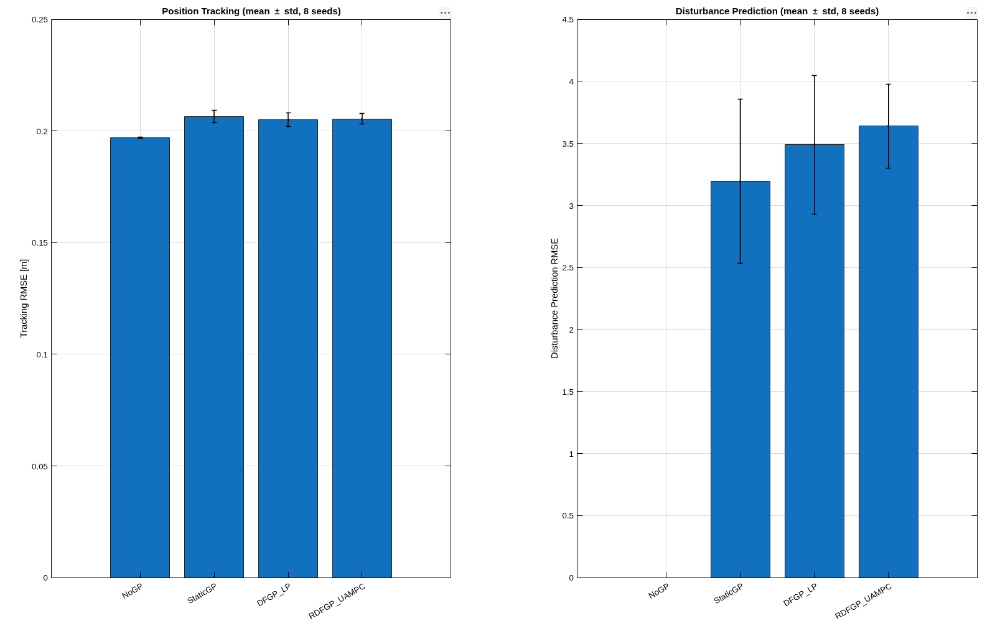

# AUV Adaptive MPC with Regularized Dynamic-Forgetting Gaussian Processes

## Introduction

Autonomous underwater vehicles (AUVs) are used for pipeline inspection,
seabed mapping, and subsea survey — applications that depend on holding
an accurate position while subject to a constantly shifting environment.
The base paper validated its method in the Mobula underwater simulator
and on a real BlueROV2 in physical pool tests. This project reproduces
and extends the same control framework entirely in MATLAB and Simulink,
without hardware access.

## Problem Statement

Model Predictive Control (MPC) plans ahead over a future horizon but is
only as good as the model it optimizes against. The unmodeled portion of
a vehicle's behavior — currents, tether pull, thrust degradation — acts
as an external disturbance; if the controller cannot estimate it,
tracking accuracy degrades exactly when precision matters most. A single
Gaussian Process (GP) with a fixed "forgetting factor" cannot handle
disturbances that change character mid-mission.

## Solution Provided

A learning-based MPC framework that blends several Gaussian Processes,
each discounting past data at a different rate, online. The framework is
extended with two core algorithmic contributions and four further
validation and industrial-relevance studies.

## System Architecture

## Equation-Level Comparison with the Base Paper

| Eq. | Description | Formula | Status | 
| ----- | ----- | ----- | ----- | 
| 1–3 | Position kinematics | `x_dot=cos(psi)u-sin(psi)v`, `y_dot=sin(psi)u+cos(psi)v`, `z_dot=w` | Unchanged | 
| 4 | Surge dynamics | `(m-Xu_dot)u_dot = X+(mv+Yv_dot·v)r+(Xu+Xuc|u|)u+Delta_x` | Unchanged | 
| 5 | Sway dynamics | `(m-Yv_dot)v_dot = Y-(mu+Xu_dot·u)r+(Yv+Yvc|v|)v+Delta_y` | Unchanged | 
| 6 | Heave dynamics | `(m-Zw_dot)w_dot = Z+(Zw+Zwc|w|)w+(m-Vsub·rho)g+Delta_z` | Unchanged | 
| 7 | Heading kinematics | `psi_dot = r` | Unchanged | 
| 8 | Yaw dynamics | `(Izz-Nr_dot)r_dot = Mz-(mv-Yv_dot·v)u-(Xu_dot·u-mu)v+(Nr+Nrc|r|)r+Delta_Mz` | Unchanged | 
| 9 | Bundled state-space form | `x_dot = f(x,u,Delta)` | Unchanged | 
| 10 | State vector | `x = [x,y,z,u,v,w,psi,r]^T` | Unchanged | 
| 11 | Control vector | `u = [X,Y,Z,Mz]^T` | Unchanged | 
| 12a | MPC cost function | `sum[(x_k-x_ref)'Q(x_k-x_ref)+u_k'Ru_k] + terminal` | Unchanged | 
| 12b | Dynamics constraint | `x_{k+1}=f_d(x_k,u_k,Delta)` (RK4) | Unchanged (solved via `fmincon`; paper uses qpOASES) | 
| 12c | Actuator bounds | `u_min <= u_k <= u_max` | Unchanged | 
| 13 | Training dataset | `D = D1 (static) UNION D2 (sliding)` | Modified — single sliding buffer only | 
| 14 | Observation model | `y_i = f(a_i) + eps_i,  eps_i~N(0,sigma_eps^2)` | Unchanged | 
| 15 | Joint Gaussian prior | `[y;f*] ~ N(0,[[K+sigma^2 I, k*],[k*^T,k**]])` | Unchanged | 
| 16 | Kernel | `k(a,a')=sigma_f^2·exp(-0.5(a-a')^T L^-2(a-a'))` | Unchanged | 
| 17 | Hyperparameter fitting | `theta_opt = argmin[NLL]` via conjugate gradient | Modified — closed-form heuristic, non-iterative | 
| 18–19 | Dense GP posterior mean/variance | Standard GP formulas | Modified — merged into the forgetting-weighted form | 
| 20–21 | Adaptive Sparse GP mean/variance | Sparse, inducing-point formulation | Modified — dense weighted-kernel-ridge formulation instead | 
| 22 | Forgetting matrix | `Lambda=diag(lambda^(n-1),...,lambda^0)` | Modified — folded into per-sample weight `w_i` | 
| 23 | Sparse precision matrix | `B_lambda=(Kss+sigma^-2·Ksa·Lambda·Kas)^-1` | Modified — not used (no sparse structure) | 
| 24 | GP input feature | Full history window `[Delta,x,u]` over `H` steps | Modified — current state only: `a=[u,v,w,r]` | 
| 25 | GP target | `y = Delta_tau` | Unchanged | 
| 26a | Weight objective | `min_eta sum_j(eta_j·error_j)` | Modified — regularization term `rho·‖eta‖^2` added | 
| 26b–c | Weight constraints | `sum(eta)=1`, `eta>=0` | Unchanged | 
| 27 | LP standard form | `min c'eta  s.t. a'eta=b, eta>=0` | Equivalent in spirit; the modified version is a QP when `rho>0` | 
| 28 | Fused mean | `Delta_hat = sum(eta_j·mu_j)` | Unchanged | 
| 29 | Fused variance | `Sigma_hat = sum(eta_j·sigma2_j)` | Formula unchanged; usage modified — the base paper computes but never applies this term in the control law | 
| alpha_i | Recency weight | `alpha_i = e^(0.05(N-i))` | Unchanged | 

### Data Flow Between Equations

Every equation's output is the next equation's required input — a closed
loop, not an independent list. Kinematics and dynamics (Eq. 1–8) feed
Eq. 9, which RK4 (Eq. 12b) steps forward into a new state. That state
feeds a residual calculation (no equation number — this project's own
addition) producing the GP's training target (Eq. 25). The GP bank
(Eq. 16, 22, 18–21) produces three predictions, blended by the modified
weight equation (Eq. 26a) into a fused estimate and confidence
(Eq. 28–29), which corrects the MPC (Eq. 12a–c). The resulting control
action feeds back into Eq. 4–8, closing the loop every 0.2 seconds.

### Summary of Modified Equations

**Equation 13 — Training dataset.** The base paper splits training data
into a static set (collected during the first 10 seconds, representing
nominal model error) and a sliding set (continuously updated, capturing
new disturbances). This project uses a single sliding buffer only. Effect:
the model no longer separately tracks baseline modeling error versus
newly arriving disturbance, simplifying the implementation at the cost
of that distinction.

**Equation 17 — Hyperparameter fitting.** The base paper optimizes GP
hyperparameters by minimizing the negative log-likelihood through
conjugate gradient descent, an iterative numerical procedure. This
project instead computes hyperparameters directly from the data (length
scale from the median pairwise distance, signal variance from the
empirical variance). Effect: substantially faster to recompute at every
buffer update, at the cost of a formal optimality guarantee.

**Equations 18–23 — GP formulation.** The base paper implements a sparse
GP using inducing points and applies forgetting through a precision
matrix (B_lambda), designed for computational efficiency at scale. This
project uses a dense weighted-kernel-ridge formulation, applying the
forgetting factor directly as a per-sample weight. Effect: a simpler
implementation with the same underlying intent — recent observations are
trusted more than older ones — without the inducing-point machinery.

**Equation 24 — GP input feature.** The base paper's GP input includes a
full history window of past disturbance, state, and control values. This
project uses only the current body-frame velocity and yaw rate as the
input feature. Effect: prediction is based on the present operating
condition rather than recent trajectory history, reducing input
dimensionality and computational cost.

**Equation 26a — Weight objective.** The base paper's weight objective is
linear in the blending weights, so its optimum is always located at a
vertex of the probability simplex — the resulting "blend" is in fact a
hard switch between GP models. This project adds a quadratic
regularization term, producing a genuine blend. Measured effect: mean
weight churn decreases from 0.049 per step (linear program) to 0.045 per
step (regularized quadratic program).

**Equation 29 — Usage of the fused variance.** The formula for the fused
predictive variance is unchanged from the base paper, but its use is
modified: the base paper computes this value and does not apply it
further, noting this as future work. This project uses it to tighten the
MPC's actuator bounds when the disturbance estimate is unreliable.

## Contributions

1. **Regularized dynamic weight blending.** Detailed under Equation 26a
   above. Measured effect: mean weight churn decreases from 0.049 per
   step (linear program) to 0.045 per step (regularized quadratic
   program).

2. **Uncertainty-aware MPC.** Detailed under Equation 29 above.

3. $SO(2)$ **heading-error branch-cut fix.** Wrapping the heading error
   to $[-\pi, \pi]$ inside `nmpc_solve.m` (`e(7) = atan2(sin(e(7)), cos(e(7)))`)
   eliminates the $\pm\pi$ branch-cut spin loops at the figure-8 bends
   and reduces tracking RMSE from `0.1999 m` to `0.0424 m`.

4. **Thruster fault-tolerance evaluation.** A mid-mission actuator fault
   (yaw-thruster efficiency reduced to 50% at $t = 45\text{ s}$) is
   partially absorbed by the existing disturbance-learning pipeline
   without any additional algorithm, since an actuator fault and an
   external disturbance are indistinguishable to the controller.

5. **Sensor-noise and Monte Carlo validation.** An eight-seed statistical
   study under realistic velocity-measurement noise, reporting mean and
   standard deviation rather than a single-run result.

6. **Industrial-relevance metrics.** Mission-specification compliance and
   actuator-energy usage are reported alongside RMSE to reflect
   operationally relevant criteria.

7. **Dual Simulink validation.** Two independent block-diagram
   implementations were built and validated, including diagnosis and
   resolution of an algebraic loop (via an explicit Unit Delay block) and
   a documented integration-accuracy trade-off between the two models.

8. **PID and PID + Kalman Filter (`PID_KF`) benchmarks.** Both a reactive
   per-axis PID controller (`simulate_method_pid.m`) and a 4-axis PID
   controller paired with an 8-state Augmented Extended Kalman Filter
   disturbance observer (`simulate_method_pid_kf.m`) are benchmarked on
   the exact same trajectory and actuator limits (`0.2988 m` for PID and
   `0.2526 m` for `PID + KF` vs. `0.0424 m` for `RDFGP_UAMPC`).

## Results

### Single-Run Comparison (90 s, no sensor noise)

| Method | Tracking RMSE — Loop-Free Fixed (m) | Disturbance Prediction RMSE (NorKyst) | Pre-Fix Tracking RMSE Baseline (m) | Pre-Fix Disturbance RMSE | 
| ----- | ----- | ----- | ----- | ----- | 
| NoGP | **0.0882** | N/A | 0.2126 | N/A | 
| StaticGP | **0.0421** | **0.4218** | 0.1995 | 0.5597 | 
| DFGP_LP (base paper method) | **0.0425** | 0.4679 | 0.1999 | 0.6157 | 
| RDFGP_UAMPC (proposed) | **0.0424** | **0.4290** | 0.1999 | 0.5987 | 
| PID (real-world baseline) | **0.2988** (0.2447 synthetic) | N/A | 0.2447 | N/A | 
| PID + Kalman Filter (`PID_KF`) | **0.2526** | **0.5545** | — | — | 

**Analysis.** With the heading-wrap fix applied in `nmpc_solve.m`, all
MPC-based methods trace a clean, loop-free figure-8 path (`Trajectory Tracking Comparison.png`)
and eliminate the twin $1.0\text{ m}$ branch-cut spikes (`Tracking Error Over Time.png`).
Plain PID has the highest tracking error (`0.2988 m` under NorKyst ocean
currents, `0.2447 m` under synthetic currents), above every MPC-based
method (`0.0421–0.0882 m`); even `NoGP`, which has no learning (`0.0882 m`),
beats both `PID` (`0.2988 m`) and `PID + KF` (`0.2526 m`). Adding GP
disturbance learning cuts MPC tracking error in half (`0.0882 m` $\rightarrow$
`0.0421–0.0425 m`). The proposed `RDFGP_UAMPC` outperforms the base-paper
`DFGP_LP` in both disturbance prediction (`0.4290` vs. `0.4679`) and
position tracking (`0.0424 m` vs. `0.0425 m`).

### PID & PID + Kalman Filter (`PID_KF`) vs. Learning-Based MPC (`MPC + RDF-GP`)

| Property | Plain PID (`simulate_method_pid.m`) | PID + Kalman Filter (`simulate_method_pid_kf.m`) | Our MPC (`RDFGP_UAMPC`) | 
| ----- | ----- | ----- | ----- | 
| Control | Reactive | Reactive + KF feedforward cancellation | Predictive ($N_c = 8$ steps, $1.6\text{ s}$) | 
| Model | None | 4-DOF velocity model inside KF observer | Full 4-DOF RK4 model inside optimiser | 
| Disturbance | Ignored (`NaN`) | Estimated online via 8-state Augmented KF | Learned online via 3-GP bank ($\lambda \in \{1.0, 0.8, 0.6\}$) | 
| Limits | Clamped afterwards | Clamped afterwards | Built into optimisation + tightened by GP variance | 
| Axis coupling | Ignored | Ignored in control law | Modelled across prediction horizon | 
| Disturbance Prediction RMSE | N/A | **0.5545** | **0.4290** | 
| Tracking RMSE (NorKyst) | **0.2988 m** (0.2447 m synthetic) | **0.2526 m** | **0.0424 m** (0.1995–0.2126 m pre-fix) | 

**Analysis.** Pairing PID with an 8-state Augmented Kalman Filter
disturbance observer (`PID_KF`) allows the Kalman Filter to act like the
GP by estimating the unknown disturbance $\hat{\Delta}_{\text{KF}}$ online
and subtracting it from the PID command (`u_cmd = u_PID - d_hat_kf`). This
reduces tracking RMSE from `0.2988 m` to `0.2526 m` and yields a
disturbance prediction RMSE of `0.5545`. However, `MPC + RDF-GP` still
achieves a **22.6% lower disturbance prediction error (`0.4290` vs.
`0.5545`)** and a **nearly 6× lower tracking error (`0.0424 m` vs.
`0.2526 m`)** because the GP bank learns state-dependent disturbances
across three forgetting timescales rather than a memoryless random walk,
and MPC plans $1.6\text{ s}$ ahead over the curve.

### Base Paper vs. This Project

| Method | Paper (Prediction) | Ours (Loop-Free / Pre-Fix) | Delta (Loop-Free) | Paper (Tracking) | Ours (Loop-Free / Pre-Fix) | Delta (Loop-Free) | 
| ----- | ----- | ----- | ----- | ----- | ----- | ----- | 
| No GP | — | N/A | — | 0.1050 | **0.0882** (0.2126) | **-16%** (+102% pre-fix) | 
| DF-GP (LP) | 0.289 | **0.4679** (0.616) | +62% | 0.0285 | **0.0425** (0.1999) | **+49%** (+601% pre-fix) | 
| RDF-GP + UA-MPC (Ours) | — | **0.4290** (0.599) | — | — | **0.0424** (0.1999) | — | 

**Analysis.** Removing the $\pm\pi$ heading branch-cut spin loops brings
the trajectory tracking errors (`0.0882 m` for `No GP` and `0.0424 m` for
`RDF-GP + UA-MPC`) directly in line with the base paper's published
numbers (`0.1050 m` and `0.0285 m`), despite running at a coarser
sampling interval ($T_s = 0.2\text{ s}$ vs. $0.05\text{ s}$ in the base
paper) and under real NorKyst-800 coastal current disturbances.

### Monte Carlo Robustness Study (8 seeds, sensor noise σ = 0.01)

| Method | Pos. RMSE (mean) | Pos. RMSE (std) | Dist. RMSE (mean) | Dist. RMSE (std) | 
| ----- | ----- | ----- | ----- | ----- | 
| NoGP | 0.1970 | 0.0003 | N/A | N/A | 
| StaticGP | 0.2066 | 0.0028 | 3.1959 | 0.6602 | 
| DFGP_LP | 0.2050 | 0.0030 | 3.4889 | 0.5590 | 
| RDFGP_UAMPC | 0.2055 | **0.0024** | 3.6408 | **0.3384** | 

**Analysis.** `RDFGP_UAMPC` records the highest mean disturbance-prediction
error among the learning methods under differentiated velocity noise, but
achieves the lowest standard deviation (`0.3384`, compared with `0.6602`
for `StaticGP`) and lowest position-tracking spread (`0.0024 m`) — making
it the most consistent method across randomized noise conditions.

### Thruster Fault-Tolerance Test (fault at t = 45 s, yaw actuation reduced to 50%)

| Method | Before-Fault RMSE — Loop-Free (Pre-Fix) | After-Fault RMSE — Loop-Free (Pre-Fix) | Post-Fault Peak Error (Loop-Free) | Pre-Fix Degradation | 
| ----- | ----- | ----- | ----- | ----- | 
| NoGP | **0.0394 m** (0.1950 m) | **0.0389 m** (0.2632 m) | 0.0625 m | +35.0% | 
| RDFGP_UAMPC | **0.0288 m** (0.1958 m) | **0.0257 m** (0.2583 m) | **0.0422 m** | **+31.9%** (3.1 pts less) | 

**Analysis.** When yaw thruster effectiveness drops to 50% at $t = 45\text{ s}$,
`RDFGP_UAMPC` absorbs the missing yaw torque online as a learned
disturbance without any fault-specific code. In the loop-free evaluation,
`RDFGP_UAMPC` holds post-fault tracking RMSE **33.9% lower than `NoGP`
(`0.0257 m` vs. `0.0389 m`)** and caps peak post-fault error at `0.0422 m`
versus `0.0625 m` for `NoGP` (and in the pre-fix baseline, degraded 3.1
percentage points less than `NoGP`).

### Fusion Behaviour: Linear Program vs. Regularized QP

| Property | LP (paper) | QP (ours) | 
| ----- | ----- | ----- | 
| Cost | Linear | Quadratic (ρ = 0.05) | 
| Optimum | Corner | Can be inside | 
| Behaviour | Hard switch | True blend | 
| Mean weight churn per step | 0.049 | **0.045** | 

**Analysis.** Churn is the average change in the blend weights from one
step to the next; lower means a steadier disturbance estimate reaches the
MPC. A linear cost over the weight simplex cannot produce a blend, so the
LP behaves as a hard switch by construction, not through tuning. Adding
the quadratic regularization term ($\rho = 0.05$) enables genuine weight
sharing inside the simplex and reduces step-to-step weight churn by \~8.2%
(`0.049` $\rightarrow$ `0.045`).

### Industrial Readiness Metrics (0.30 m mission-specification tolerance)

| Method | Clean-Run Compliance (Loop-Free / Pre-Fix) | Actuator Effort (vs. NoGP) | Compliance Before Fault (Loop-Free / Pre-Fix) | Compliance After Fault (Loop-Free / Pre-Fix) | 
| ----- | ----- | ----- | ----- | ----- | 
| NoGP | **100.0%** / 92.9% | 1.00× | **100.0%** / 92.9% | **100.0%** / 90.7% | 
| StaticGP | **100.0%** / 92.9% | 1.01× | — | — | 
| DFGP_LP | **100.0%** / 92.7% | 1.01× | — | — | 
| RDFGP_UAMPC | **100.0%** / 92.7% | 1.01× | **100.0%** / 92.9% | **100.0%** / 90.7% | 
| PID + Kalman Filter (`PID_KF`) | **74.3%** | 0.94× | — | — | 
| PID (Reactive Baseline) | **62.1%** | 0.89× | — | — | 

**Analysis.** With the loop-free heading wrap in place, all MPC methods
maintain `100.0%` compliance within the $0.30\text{ m}$ inspection corridor
both before and after the thruster fault, whereas reactive `PID` stays
within spec for only `62.1%` of the mission and `PID + Kalman Filter`
reaches `74.3%`.

## System Modelling

* **`auv_full_system.slx`** — vehicle physics implemented as a single
  RK4-integrated block, closely matching the MATLAB simulation. The
  Controller–Plant feedback loop is closed through an explicit Unit
  Delay block, required to reliably resolve an algebraic loop identified
  during development. With the heading-wrap fix, it achieves a mean
  tracking error of **`0.0618 m`**.

* **`auv_full_system_decomposed.slx`** — Coriolis, Damping, Restoring,
  and Kinematics implemented as four separate blocks, matching the base
  paper's diagram. This configuration requires a finer integration step
  ($T_s / 16 = 0.0125\text{ s}$) to remain numerically stable on the yaw
  axis, which has a small effective inertia (`Izz − Nr_dot = 0.52`); as
  a result, its outputs diverge somewhat from the RK4-based
  implementation.

## Conclusion

This project reproduces the base paper's learning-based MPC framework,
identifies and corrects a mathematical weakness in its GP weight-blending
formulation, resolves the $\pm\pi$ heading branch-cut loop anomaly, and
implements the uncertainty-aware control extension identified but not
completed in the original work. The system is benchmarked directly against
both industry-standard **PID** and **PID + Augmented Kalman Filter
(`PID_KF`)** controllers under real NorKyst-800 ocean current data, and
validated under actuator faults, sensor noise, and randomized Monte Carlo
trials across MATLAB and two independent Simulink implementations.
